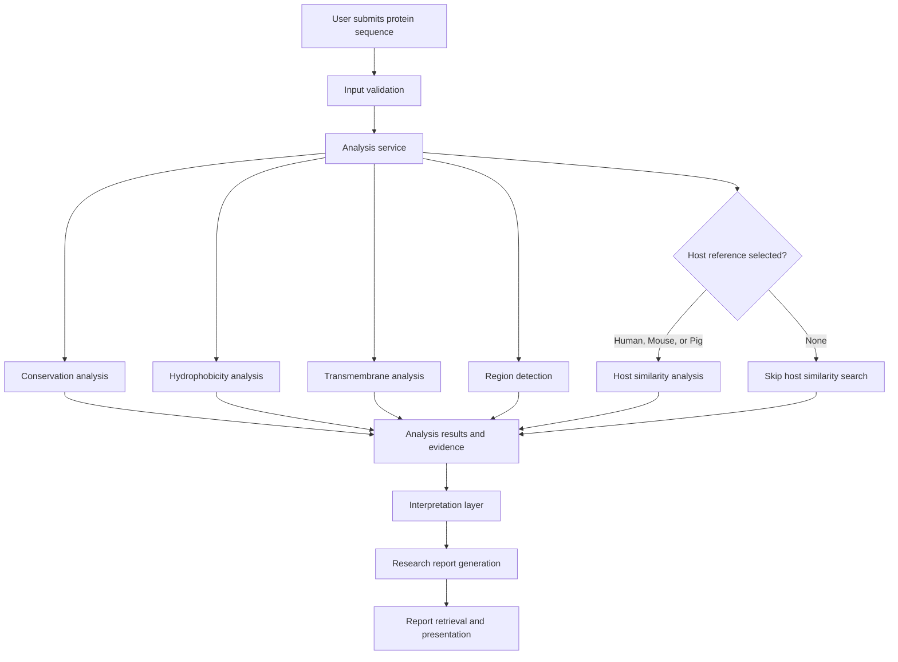
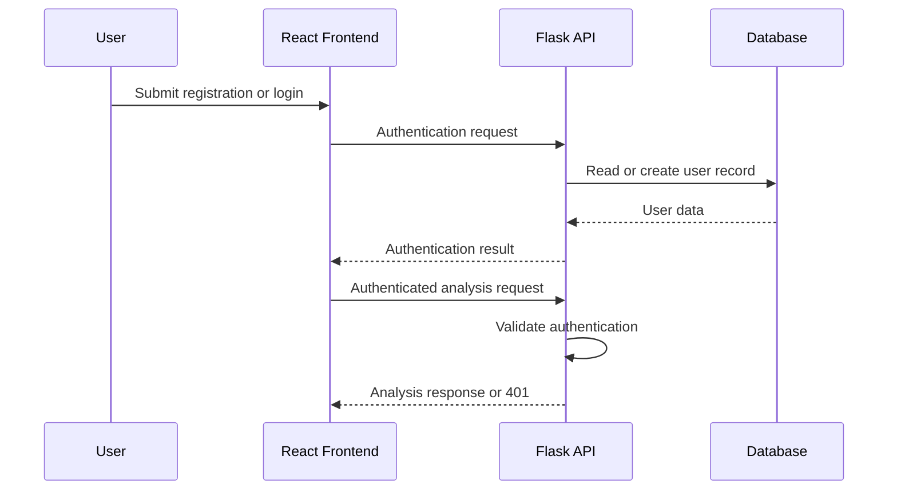

# ReverseVax

**An explainable, web-based reverse vaccinology platform for computational protein screening and vaccine candidate prioritisation.**

<!-- TODO: Add a repository release version before publishing version-specific badges. -->


> **Project status:** Active development. Started on 19 September 2026.

ReverseVax combines bioinformatics analysis, a web-based workflow, and an interpretation layer to help researchers investigate pathogen protein sequences and identify candidates that warrant further investigation.

**Repository:** [Kipchumba-ke/](https://github.com/Kipchumba-ke/Reverse-Vaccinology-Research-Engine)

---

## Table of Contents

- [1. Overview](#1-overview)
- [2. Features](#2-features)
- [3. How It Works](#3-how-it-works)
- [4. Analysis Methods](#4-analysis-methods)
- [5. Screenshots and Demo](#5-screenshots-and-demo)
- [6. Technology Stack](#6-technology-stack)
- [7. Architecture and Project Structure](#7-architecture-and-project-structure)
- [8. Getting Started](#8-getting-started)
- [9. Usage](#9-usage)
- [10. API Reference](#10-api-reference)
- [11. Authentication](#11-authentication)
- [12. Sample Research Report](#12-sample-research-report)
- [13. Limitations and Scientific Disclaimer](#13-limitations-and-scientific-disclaimer)
- [14. Testing](#14-testing)
- [15. Roadmap](#15-roadmap)
- [16. Contributing](#16-contributing)
- [17. Troubleshooting and FAQ](#17-troubleshooting-and-faq)
- [18. References and Acknowledgements](#18-references-and-acknowledgements)
- [19. License](#19-license)
- [20. Author](#20-author)

---

## 1. Overview

### What is reverse vaccinology?

Reverse vaccinology is an approach to vaccine research that begins with computational analysis of a pathogen's biological information rather than relying exclusively on traditional laboratory screening. Researchers can investigate pathogen proteins and prioritise candidates based on characteristics that may make them relevant to further vaccine research.

### Why ReverseVax?

Identifying promising proteins from a pathogen proteome can be time-consuming and expensive when performed through manual investigation and extensive experimental screening alone.

ReverseVax aims to make the initial computational screening process more accessible by analysing protein sequences, organising the resulting evidence, and translating computational outputs into an explainable research report.

The objective is to help researchers **prioritise candidates for further investigation**, not to declare that a computationally selected protein is an effective vaccine antigen.

### Who is it for?

ReverseVax is intended for:

- **Bioinformaticians** investigating pathogen protein sequences and computational screening methods.
- **Vaccine researchers** looking for ways to organise evidence and prioritise candidates for experimental evaluation.
- **Students** learning bioinformatics, computational biology, and reverse vaccinology.
- **Software developers in computational biology** interested in building and extending scientific analysis pipelines.

### Project goals

ReverseVax is being developed around three principles:

1. **Computational analysis:** Apply defined analytical methods to protein sequence data.
2. **Explainability:** Connect computational findings with readable interpretations and supporting evidence.
3. **Reproducibility:** Organise analysis results and reference data so that research workflows can be inspected, tested, and improved.

---

## 2. Features

ReverseVax is under active development. Features are grouped below according to the current project information. Where implementation details have not yet been verified, the status is explicitly marked for confirmation.

### Implemented

| Feature | Description |
|---|---|
| Protein analysis pipeline | Coordinates the analysis of submitted protein sequences. |
| Conservation analysis | Evaluates sequence conservation and conserved regions. |
| Hydrophobicity analysis | Examines hydrophobic properties of protein sequences. |
| Transmembrane analysis | Identifies and interprets transmembrane candidates. |
| Region detection | Supports the identification of relevant protein regions. |
| Host similarity analysis | Supports similarity searches against configured host proteome references. |
| Interpretation layer | Converts computational results into readable explanations. |
| Research report generation | Combines analysis results and interpretations into a structured report. |
| Flask API | Provides the backend interface for submitting and retrieving analyses. |
| Authentication | Registration and login functionality has been implemented. |
| React frontend | Provides the web interface for submitting sequences and displaying analysis results. |
| Analysis status polling | The frontend can request analysis status while processing is pending or running. |
| Host reference selection | Supports human, mouse, pig, and no-host-reference selection. |
| Local BLAST reference databases | Supports locally configured host proteome databases for similarity analysis. |
| Automated tests | A pytest suite covers API behaviour and other backend and frontend components. |
| Background analysis jobs | Use Celery and Redis to manage long-running analysis tasks. |
| Extended bioinformatics integrations | Integrate additional sequence databases and multiple-sequence alignment tools as appropriate. |
| Application orchestration | Continue refining the separation between HTTP routes, services, analysis logic, evidence, interpretation, and report generation. |
| Persistence | Continue integrating users, analyses, proteins, analysis results, evidence, and reports into the data layer. |
| Reference-data reproducibility | Document reference provenance, checksums, database generation, and setup procedures. |
| External bioinformatics integration | Improve the integration of external sequence databases and analysis tools. |
| Analysis execution | Develop the infrastructure needed to manage longer-running analyses reliably. |
| Documentation | Complete API contracts, configuration guidance, and deployment instructions. |

### Planned

| Feature | Description |
|---|---|
| Enhanced visualisations | Expand the visual presentation of analysis results and supporting evidence. |
| Reproducible analysis metadata | Record the reference versions, software configuration, and parameters required to interpret results. |
| Deployment workflow | Document and validate a complete production deployment. |
| Expanded scientific validation | Evaluate analysis methods and their interpretations against appropriate reference datasets and research evidence. |


---

## 3. How It Works

ReverseVax follows a workflow that separates sequence analysis from interpretation and report generation.

### Analysis workflow

1. **Sequence submission**

   A user submits a pathogen protein sequence through the web interface or API.

2. **Input validation**

   The application checks the submitted input before analysis.

   <!-- TODO: Document the exact accepted sequence formats, validation rules, and maximum input size. -->

3. **Analysis orchestration**

   The application coordinates the analysis workflow through its service and analysis layers.

4. **Conservation analysis**

   The sequence is examined for conservation-related properties and conserved regions.

5. **Hydrophobicity analysis**

   The analysis evaluates hydrophobic properties along the protein sequence.

6. **Transmembrane analysis**

   The pipeline examines transmembrane candidates.

7. **Region detection**

   Relevant sequence regions are identified for further interpretation.

8. **Host similarity analysis**

   Where configured and selected, the application compares the submitted protein against a host reference database using BLASTP.

   Supported host-reference selections include human, mouse, pig, and none.

9. **Evidence collection and interpretation**

   Computational results are passed to the interpretation layer, which produces explanations of the findings.

10. **Research report generation**

    The reporting layer combines the available analysis results and interpretations into a readable research report.

11. **Result retrieval**

    The frontend retrieves the analysis status and displays the available results.

### Workflow diagram



The diagram represents the conceptual workflow. The exact execution order, persistence behaviour, and background-processing implementation may differ as the application evolves.

### Scoring and prioritisation

ReverseVax is intended to support candidate prioritisation using computational evidence.

<!-- TODO: Document whether a combined candidate score exists, its formula, the contribution of individual analysis methods, thresholds, confidence categories, and how missing results are handled. -->

Until a scoring method is explicitly defined and documented, individual analysis results and their interpretations should not be mistaken for a validated overall vaccine-candidacy score.

---

## 4. Analysis Methods

ReverseVax currently includes several sequence-analysis components. The methods table distinguishes the scientific purpose of each component.

| Analysis | What it measures | Why it may matter |
|---|---|---|
| Conservation | Similarity or preservation of sequence positions or regions across compared sequences. | Conserved regions may be useful when investigating whether a target is shared across related pathogen variants. | 
| Conserved-region detection | Regions containing conserved sequence positions. | Helps identify portions of a protein that may warrant further investigation. |
| Hydrophobicity | The hydrophobic character of amino acids along a protein sequence. | Can help characterise protein regions and support the interpretation of potential membrane-associated properties. | Project hydrophobicity-analysis module. Exact scale and window parameters require documentation. |
| Transmembrane analysis | Candidate regions that may cross a biological membrane. | Membrane-associated regions may be relevant to investigating protein localisation and accessibility, depending on the protein and biological context. | Project transmembrane-analysis module. Exact prediction algorithm requires documentation. |
| Region detection | Relevant regions identified by the analysis pipeline. | Helps organise sequence-level findings for interpretation and reporting. |
| Host similarity | Similarity between a submitted protein and proteins in a selected host reference database. | Can provide evidence for investigating similarities between pathogen proteins and host proteins. |
| Interpretation | Explanations derived from computational analysis results. | Makes technical results easier to inspect and understand. |
| Report generation | Aggregation of results, evidence, and interpretations. | Provides a structured summary for research review. |

### Host similarity and reference databases

The application supports the following host references:

| Host | Scientific name | Reference identifier |
|---|---|---|
| Human | *Homo sapiens* | UniProt proteome `UP000005640` |
| Mouse | *Mus musculus* | UniProt proteome `UP000000589` |
| Pig | *Sus scrofa* | UniProt proteome `UP000008227` |

The available local reference files include:

| Host | FASTA records in the current reference |
|---|---:|
| Human | 169,651 |
| Mouse | 54,855 |
| Pig | 46,079 |

These counts describe the current local datasets. They do not establish that the references are complete, current, or derived from comparable releases.

The mouse reference has an additional candidate dataset containing 63,328 records, including 8,473 identifiers absent from the existing reference. The shared identifiers have identical sequences in the compared files. The candidate is being evaluated separately and should not be assumed to be the active reference.

Generated BLAST database indexes are built locally from FASTA files.

For reference setup instructions, see [`data/reference/host-proteomes.md`](data/reference/host-proteomes.md).

### Interpretation of results

A computational result is evidence about a defined sequence property, not proof of vaccine effectiveness.

Interpretations should identify the finding, explain its potential significance, and make limitations clear. Conclusions about vaccine candidacy require additional evidence that is not established by sequence analysis alone.

---

## 5. Screenshots and Demo

**Live demo:** Not yet available.

Screenshots will be added as the interface and reporting workflow mature.

### Sequence submission interface

<!-- TODO: Add a screenshot of the protein sequence submission page. -->


### Analysis results and visualisations

<!-- TODO: Add a screenshot showing analysis results and visualisations. -->


### Research report

<!-- TODO: Add a screenshot of a generated research report using clearly labelled demonstration data. -->


---

## 6. Technology Stack

The project uses a Python backend and React frontend, with relational persistence and infrastructure components intended to support analysis execution and deployment.

| Layer | Technology | Purpose | Status |
|---|---|---|---|
| Programming language | Python | Backend services and bioinformatics analysis. | Current |
| Web framework | Flask | HTTP API and application routes. | Current |
| Bioinformatics | Biopython and project analysis modules | Protein sequence processing and analysis support. | Current
| Sequence similarity | NCBI BLAST+ | Protein similarity searches against configured host references. | Current |
| Relational database | PostgreSQL | Persistent application data. | Current|
| Lightweight database | SQLite | Local development and testing where configured. | Current|
| ORM | SQLAlchemy | Database models and persistence. | Current |
| Database migrations | Alembic | Database schema migrations. | Current |
| Frontend | React | User interface. | Current |
| Frontend build tooling | Vite | Frontend development and build workflow. | Current |
| Analysis visualisation | React-based visualisation components | Display analysis results. | Current |
| Task queue | Celery | Background execution of longer-running tasks. | Current |
| Message broker / task infrastructure | Redis | Infrastructure for asynchronous jobs. | Current |
| Containerisation | Docker | Package services into reproducible environments. | Current|
| Automated testing | pytest | Test backend behaviour and analysis components. | Current |
| Code formatting | Black | Python code formatting. | Current|
| Report generation | ReportLab | PDF report generation, if used by the report service. | Current |

---

## 7. Architecture and Project Structure

ReverseVax separates API handling, application services, scientific analysis, interpretation, and report generation.

### Architectural layers

| Layer | Responsibility |
|---|---|
| API layer | Receives HTTP requests, validates request-level requirements, and returns responses. |
| Service layer | Coordinates application use cases and analysis workflows. |
| Analysis layer | Performs the computational analysis of protein sequences. |
| Evidence layer | Organises results used by downstream interpretation. |
| Interpretation layer | Converts computational outputs into explanatory findings. |
| Reporting layer | Assembles analysis results and explanations into research reports. |
| Persistence layer | Stores application data using the configured database. |
| Frontend layer | Provides sequence submission, status retrieval, and result presentation. |
| Infrastructure layer | Supports deployment and, as integration progresses, background execution. |

### Project structure

The following tree highlights project paths. It is intentionally not a complete file listing.

```text
reverse-vaccinology/
├── app/
│   ├── __init__.py
│   │   └── Flask application setup and API routes
│   ├── analysis/
│   │   ├── pipeline.py
│   │   ├── blast_runner.py
│   │   └── interpretation.py
│   │       └── Analysis, similarity search, and interpretation
│   ├── models/
│   │   ├── analysis_result.py
│   │   ├── user.py
│   │   └── user_orm.py
│   │       └── Domain and persistence models
│   ├── repositories/
│   │   └── user_repository.py
│   │       └── Data-access components
│   └── services/
│       ├── analysis_service.py
│       ├── auth_service.py
│       └── authentication.py
│           └── Application orchestration and authentication
├── data/
│   └── reference/
│       ├── human/
│       ├── mouse/
│       ├── pig/
│       ├── essentiality/
│       └── host-proteomes.md
│           └── Reference data and provenance documentation
├── migrations/
│   └── versions/
│       └── Database migration history
├── scripts/
│   ├── build_host_blast_databases.sh
│   └── download_host_proteomes.sh
│       └── Reference-data setup utilities
├── tests/
│   ├── conftest.py
│   ├── test_api.py
│   └── test_host_reference.py
│       └── Automated tests
├── requirements.txt
├── .gitignore
└── README.md
```

<!-- TODO: Verify the tree against the actual repository and add the frontend directory, Docker Compose file, configuration files, and remaining analysis modules. -->

### How the components fit together

The Flask API receives requests from the frontend. The application service coordinates analysis work without requiring the HTTP route itself to contain the scientific analysis implementation.

The analysis pipeline produces computational results, which are passed to the interpretation and reporting components. The persistence layer stores application information where configured, while the React frontend retrieves analysis status and presents results.

Host similarity analysis uses BLASTP and a database built from a selected host proteome. The local reference configuration supports separate human, mouse, and pig database paths.

The intended architecture separates long-running work from request handling.

---

## 8. Getting Started

This section documents the setup workflow.

### Prerequisites

| Dependency | Requirement | Purpose |
|---|---|---|
| Python | Python 3.12.8 is a tested project environment. | Backend and analysis execution. |
| pip | Compatible with the selected Python environment. | Install Python dependencies. |
| Git | A recent version. | Clone and manage the repository. |
| NCBI BLAST+ | A version providing `blastp` and `makeblastdb`. | Protein similarity searches and reference database construction. |
| PostgreSQL | Required if running against PostgreSQL. | Relational persistence. |
| SQLite | Available through Python's standard library. | Lightweight local persistence where configured. |
| Node.js and npm | <!-- TODO: Add tested versions. --> | React frontend development. |
| Docker Engine | <!-- TODO: Add tested version. --> | Containerised execution. |
| Docker Compose | <!-- TODO: Add tested version. --> | Multi-service development and deployment. |
| Redis | Required for Celery-based execution when enabled. | Background-task infrastructure. |

### Clone the repository

```bash
git clone https://github.com/Kipchumba-ke/Reverse-Vaccinology-Research-Engine
cd Reverse-Vaccinology-Research-Engine
```

<!-- TODO: Confirm the canonical repository URL before publishing these instructions. -->

### Create a Python environment

Using Python 3.12:

```bash
python3.12 -m vaccinology vaccinology
source vaccinology/bin/activate
```

Upgrade pip:

```bash
python -m pip install --upgrade pip
```

Install the project dependencies:

```bash
python -m pip install -r requirements.txt
```

The dependency inventory supplied during documentation preparation includes Flask, SQLAlchemy, Alembic, Biopython, Celery, Redis, psycopg, pytest, and related packages.

The exact dependency versions should be taken from the repository's current `requirements.txt`.


### Prepare host reference databases

ReverseVax uses FASTA files as inputs to BLAST database construction.

The repository includes scripts for downloading human and pig proteomes when their destination files are missing, downloading a mouse candidate separately, and building the local databases.

Download missing human and pig references while preserving existing files:

```bash
./scripts/download_host_proteomes.sh
```

To download the current mouse proteome as a separate candidate without replacing the existing reference:

```bash
./scripts/download_host_proteomes.sh --download-mouse-candidate
```

Build the host BLAST databases:

```bash
./scripts/build_host_blast_databases.sh
```

Check the BLAST executable:

```bash
"$HOME/micromamba/bin/blastp" -version
```

If BLAST+ is installed elsewhere, configure `BLASTP_EXECUTABLE` and `MAKEBLASTDB_EXECUTABLE` as appropriate.

See [`data/reference/host-proteomes.md`](data/reference/host-proteomes.md) for reference details, local database paths, and reproducibility notes.

### Running with Docker Compose

<!-- TODO: Verify the Dockerfile, Compose configuration, service names, ports, volumes, and environment variables in the repository. -->

Start the configured services.


```bash
docker compose up -d
```

To stop the services:

```bash
docker compose down
```

Use persistent volumes where necessary to retain database state. Do not delete volumes containing data unless you intend to remove that data.

### Running locally without Docker

Activate the virtual environment and install the dependencies as described above.

Prepare the database and host references, then start the Flask application using the repository's configured entry point.

<!-- TODO: Confirm the supported Flask entry point and development-server command. -->

Example command pattern:

```bash
flask --app app run --debug
```

The command above is a placeholder until the application's Flask entry point and configuration have been verified.

The React frontend must also be installed and started from its actual project directory.

<!-- TODO: Document the frontend directory, package manager, installation command, development command, and API base URL. -->

### Database setup and migrations

The project uses SQLAlchemy and Alembic for relational persistence and schema migrations.

First, configure the database connection using the variable and format supported by the application.

Inspect the available migration history:

```bash
ls migrations/versions/
```

Apply migrations using the project's Alembic configuration:

```bash
alembic upgrade head
```

This command assumes the repository's Alembic configuration and database URL are set up correctly.

Inspect the current migration revision:

```bash
alembic current
```

Inspect available migration history:

```bash
alembic history
```

Before applying migrations to an existing database, back up important data and verify that the target database is the intended one.

<!-- TODO: Document database creation, development seeding, migration configuration, rollback procedures, and any application-specific initialization command. -->

---

## 9. Usage

ReverseVax accepts protein sequence input through its analysis workflow. The frontend submits an analysis request to the backend and polls for its status.

### Submit an analysis

The analysis endpoint used by the current frontend is:

`POST /api/analyses`

A minimal request example is shown below.

```bash
curl -X POST http://localhost:5000/api/analyses \
  -H "Content-Type: application/json" \
  -H "Authorization: Bearer YOUR_TOKEN" \
  -d '{
    "sequence": "MKTAYIAKQRQISFVKSHFSRQ"
  }'
```

<!-- TODO: Confirm the required authentication header, sequence field name, accepted formats, response status code, and actual response schema. -->


### Check analysis status

The frontend uses the following status route pattern:

`GET /api/analyses/{analysisId}`

Example:

```bash
curl -X GET \
  http://localhost:5000/api/analyses/UUID\
  -H "Authorization: Bearer YOUR_TOKEN"
```

### Example JSON responses

Illustrative submission response:

```json
{
  "analysis_id": "<analysis-id>",
  "status": "pending"
}
```

Illustrative status response:

```json
{
  "analysis_id": "<analysis-id>",
  "status": "completed",
  "report": "<report-content-or-reference>"
}
```

<!-- TODO: Replace both examples with actual responses, including real status values, error responses, and report representation. -->

### Host reference selection

The application supports four host-reference choices:

| Selection | Intended behaviour |
|---|---|
| `human` | Use the configured human reference database when available. |
| `mouse` | Use the configured mouse reference database when available. |
| `pig` | Use the configured pig reference database when available. |
| `none` | Skip host-similarity searching. |

Host-reference selection is distinct from the pathogen organism being analysed.

For local databases, host-specific environment variables take precedence over the corresponding local defaults. The legacy `HOST_BLAST_DATABASE` setting remains available for compatibility with callers that do not specify a host reference.

---

## 10. API Reference

The API is under active development. This table documents known route patterns while marking details that still need confirmation.

| Method | Path | Authentication | Purpose | Request / response |
|---|---|---|---|---|
| `POST` | `/api/analyses` | Required | Submit a protein analysis. | <!-- TODO: Document exact request and response schemas. --> |
| `GET` | `/api/analyses/{analysisId}` | Required | Retrieve analysis status and available results. | <!-- TODO: Document exact identifier format and response schema. --> |
| `POST` | <!-- TODO: Confirm registration path. --> | Not required to register | Create a user account. | <!-- TODO: Document actual request and response schemas. --> |
| `POST` | <!-- TODO: Confirm login path. --> | Not required to log in | Authenticate a user. | <!-- TODO: Document actual request and response schemas. --> |

### Authentication errors

The analysis API enforces authentication and returns an HTTP `401 Unauthorized` response when the request is not authenticated.

<!-- TODO: Confirm error response bodies, validation error status codes, missing-resource behaviour, rate limiting, and all other API error contracts. -->

### API schema

<!-- TODO: Add a machine-readable OpenAPI specification and link it here once the routes and schemas have been verified. -->

---

## 11. Authentication

ReverseVax includes registration and login functionality, and the analysis API requires authentication.

The current backend includes authentication services and user persistence components. The project also has automated tests for registration and login behaviour.

### Current behaviour

- Users can register and log in through the implemented authentication functionality.
- The analysis API checks whether the request is authenticated.
- Unauthenticated analysis requests are rejected with HTTP `401 Unauthorized`.
- The frontend and API must use the authentication mechanism supported by the current backend.

### Authentication flow

The intended high-level flow is:



### Security considerations

- Never commit passwords, tokens, signing keys, or production credentials.
- Use HTTPS for deployed environments.
- Store passwords using a suitable password-hashing mechanism.
- Protect sensitive configuration through environment variables or a secret-management system.
- Define token expiration, revocation, and refresh policies before production deployment.

<!-- TODO: Document password requirements, JWT claims and expiry, token refresh behaviour, logout behaviour, and account-recovery functionality. -->


---

## 12. Sample Research Report

The following is an illustrative report format using **dummy data**. It is not an actual output from a verified analysis run and does not represent a real vaccine candidate.

### ReverseVax: Protein Analysis Report

**Report type:** Illustrative example  
**Analysis identifier:** `DEMO-001`  
**Input:** Synthetic demonstration sequence  
**Reference dataset:** Demonstration metadata only  
**Scientific status:** Not experimentally validated

#### 1. Executive summary

This example demonstrates how computational observations can be presented alongside their interpretation and limitations.

The report is intended to organise evidence for further review. It does not establish that the example protein is protective, immunogenic, safe, or suitable for use in a vaccine.

#### 2. Input information

| Field | Example value |
|---|---|
| Analysis ID | `DEMO-001` |
| Sequence source | Synthetic demonstration input |
| Sequence length | <!-- TODO: Populate from an actual test fixture. --> |
| Host reference | None |
| Analysis status | Illustrative only |

#### 3. Analysis findings

| Analysis component | Illustrative observation | Interpretation |
|---|---|---|
| Conservation | <!-- TODO: Insert an actual test result. --> | Conservation findings require the relevant comparison sequences and method to be documented. |
| Conserved regions | <!-- TODO: Insert an actual test result. --> | Region-level findings depend on the comparison dataset and analysis parameters. |
| Hydrophobicity | <!-- TODO: Insert an actual test result. --> | Hydrophobic properties provide sequence-level evidence, not proof of antigen accessibility. |
| Transmembrane analysis | <!-- TODO: Insert an actual test result. --> | Predicted transmembrane regions require appropriate biological interpretation. |
| Host similarity | Not run in this example. | No host-similarity conclusion can be drawn. |

#### 4. Candidate prioritisation

**Overall candidate score:** Not provided.


#### 5. Limitations

- The example uses dummy report content.
- No experimental validation has been performed.
- The analysis methods and parameters must be documented alongside actual findings.
- Computational observations alone cannot establish vaccine efficacy or safety.


---

## 13. Limitations and Scientific Disclaimer

ReverseVax is a computational research aid. Its outputs are intended to support investigation and prioritisation, not to replace experimental validation or expert scientific judgement.

### Scientific limitations

**Sequence analysis is not experimental validation.**

A protein's computationally predicted properties do not establish that it will produce a protective immune response.

**Conservation is context-dependent.**

A conserved region may be relevant to cross-variant investigation, but conservation alone does not establish immunogenicity, accessibility, or protection.

**Hydrophobicity and transmembrane predictions have limitations.**

These properties can support protein characterisation but do not independently establish whether a protein will be accessible to antibodies or suitable for a vaccine.

**Host similarity requires careful interpretation.**

A similarity search identifies sequence relationships under the chosen search conditions. Similarity results alone do not establish cross-reactivity, clinical risk, or biological effect.

**Reference datasets affect results.**

Different proteome versions, isoform choices, database contents, and analysis parameters can affect reported findings. Reference provenance and configuration should be recorded for reproducibility.

**Interpretations depend on the underlying methods.**

Readable explanations do not remove the uncertainty or limitations of the computational methods that generated the results.

### Intended use

ReverseVax is intended for educational and research purposes, including computational investigation of pathogen proteins.

It does not establish:

- Vaccine efficacy or safety.
- Protective immunogenicity.
- Clinical suitability.
- Regulatory approval.
- Experimental confirmation of predicted properties.

**All candidate findings require appropriate scientific review and experimental validation before they can support claims about vaccine performance.**

Users are responsible for evaluating the reliability of results, checking the source and quality of reference data, and complying with applicable institutional and regulatory requirements.

---

## 14. Testing

ReverseVax uses pytest for automated testing.

The backend test suite covers API behaviour and other application components, including authentication and host-reference handling.

### Run the complete test suite

Activate the project environment and run:

```bash
python -m pytest -q
```

For verbose output:

```bash
python -m pytest -v
```

### Run API tests

```bash
python -m pytest tests/test_api.py -v
```

### Run host-reference tests

```bash
python -m pytest tests/test_host_reference.py -v
```

### What the tests cover

| Area | Examples of covered behaviour |
|---|---|
| Authentication | Registration, login, and rejection of invalid login attempts. |
| API authentication | Authentication enforcement for protected analysis requests. |
| Host reference selection | Human, mouse, pig, and none selection handling. |
| Database configuration | Resolution of configured host databases and local defaults. |
| Compatibility | Legacy host-database configuration where supported. |
| Analysis components | Behaviour covered by the remaining test modules. |

The project has previously passed a complete backend test run with 612 tests. This is a historical result, not a guarantee that the current checkout will produce the same result.

### Testing external tools

Some integration checks require NCBI BLAST+ executables and local reference databases.

Check the BLASTP executable:

```bash
"$HOME/micromamba/bin/blastp" -version
```

Validate the database build script's syntax:

```bash
bash -n scripts/build_host_blast_databases.sh
```

Validate the reference-download script's syntax:

```bash
bash -n scripts/download_host_proteomes.sh
```

### Testing expectations

Before submitting changes:

1. Run the tests related to the changed component.
2. Run the complete backend test suite when practical.
3. Confirm that authentication remains enforced for protected routes.
4. Verify that changes to reference selection do not silently change the selected database.
5. Document any external tools or datasets required for integration tests.

<!-- TODO: Document frontend test commands, coverage reporting, integration-test fixtures, and CI configuration. -->

---

## 15. Roadmap

The roadmap reflects the current project direction. Items should be marked complete only after the corresponding implementation and tests have been verified.

### Application architecture

- [x] Flask API foundation.
- [x] Core protein-analysis pipeline.
- [x] Interpretation and report-generation components.
- [x] Registration and login functionality.
- [x] Authentication enforcement on the analysis API.
- [x] Human, mouse, and pig host-reference selection.
- [x] Local host BLAST database build script.
- [x] Reference-data documentation.
- [x] Complete the application/service orchestration layer.
- [x] Complete persistence for users, analyses, proteins, analysis results, evidence, and reports.
- [x] Document API schemas and error responses.
- [ ] Add reproducible integration tests for configured external tools.

### Bioinformatics and reproducibility

- [x] Conservation analysis.
- [x] Hydrophobicity analysis.
- [x] Transmembrane candidate analysis.
- [x] Region detection.
- [x] Host similarity analysis.
- [x] Interpretation of computational results.
- [ ] Complete documentation of algorithms, parameters, and thresholds.
- [ ] Record provenance and checksums for all reference datasets.
- [ ] Validate and document reference updates.
- [ ] Expand external bioinformatics integrations where appropriate.
- [ ] Evaluate analysis methods against appropriate reference datasets.
- [ ] Document limitations and uncertainty for each interpretation.

### Background processing and infrastructure

- [x] Complete Celery integration for long-running analysis jobs.
- [x] Complete Redis configuration for background processing.
- [x] Add documented worker startup and shutdown procedures.
- [x] Add retry, timeout, and failure-handling policies.
- [ ] Document Docker Compose services and persistent volumes.
- [ ] Establish a reproducible deployment workflow.

### Frontend and reporting

- [x] React frontend foundation.
- [x] Analysis submission and status polling.
- [x] Complete user-facing error and failure states.
- [x] Expand analysis visualisations.
- [x] Improve report presentation and export workflows.
- [ ] Add screenshots and a demonstration dataset.
- [ ] Document the frontend development and production-build commands.

### Project quality and release

- [ ] Complete this README with verified repository-specific commands.
- [ ] Add a machine-readable API specification.
- [ ] Add contribution and development guidelines.
- [ ] Establish continuous integration.
- [ ] Select and apply an explicit project licence.
- [ ] Prepare a documented demonstration release.
- [ ] Review security and scientific reproducibility before production deployment.

---

## 16. Contributing

Contributions are welcome from developers, bioinformaticians, researchers, and students interested in computational biology and scientific software.

### Before contributing

- Review the existing code and tests.
- Keep scientific assumptions and implementation details explicit.
- Avoid introducing undocumented analysis thresholds or scores.
- Preserve the separation between API routes, application services, analysis logic, interpretation, and reporting.
- Add tests for changed behaviour.
- Document any new environment variables, external tools, or reference datasets.

### Development workflow

Fork the repository on GitHub, clone your fork, and create a branch for your change.

```bash
git clone https://github.com/Kipchumba-ke/Reverse-Vaccinology-Research-Engine
cd reverse-vaccinology
git checkout -b feature/describe-your-change
```

Create and activate a Python environment, then install the dependencies:

```bash
python3.12 -m venv vaccinology
source vaccinology/bin/activate
python -m pip install -r requirements.txt
```

Implement the change and run the relevant tests:

```bash
python -m pytest -q
```

Commit your work:

```bash
git add <changed-files>
git commit -m "Add concise description of change"
```

Push your branch:

```bash
git push origin feature/describe-your-change
```

Open a pull request against the upstream repository and describe:

- The problem being addressed.
- The implementation and design decisions.
- The tests added or executed.
- Any new dependencies or configuration.
- Any changes to scientific interpretation or reference data.

### Commit conventions

Use concise, descriptive commit messages. A simple convention is:

- `feat:` for a new feature.
- `fix:` for a bug fix.
- `test:` for test additions or corrections.
- `docs:` for documentation.
- `refactor:` for structural changes that preserve behaviour.
- `chore:` for maintenance tasks.

Examples:

```text
feat: add host reference selection
fix: reject unauthenticated analysis requests
test: cover mouse reference fallback
docs: document local BLAST database setup
```

### Reference-data contributions

Reference datasets can be large and may have licensing or redistribution restrictions.

When adding or updating a dataset, document its source, retrieval date, identifier, version where available, checksum, and applicable licence. Avoid committing generated BLAST indexes unless there is a documented and justified reason to do so.

---

## 17. Troubleshooting and FAQ

### Python dependencies fail to install

Check the active Python version:

```bash
python --version
```

Confirm that the virtual environment is active:

```bash
which python
```

Upgrade pip:

```bash
python -m pip install --upgrade pip
```

Then retry the dependency installation:

```bash
python -m pip install -r requirements.txt
```

If installation still fails, inspect the complete error output and verify that the Python version is compatible with the dependency versions in the repository.

### BLASTP cannot be found

Check whether BLASTP is installed:

```bash
command -v blastp
```

If you use the Micromamba installation:

```bash
"$HOME/micromamba/bin/blastp" -version
```

Configure the executable path if necessary:

```bash
export BLASTP_EXECUTABLE="$HOME/micromamba/bin/blastp"
```

The application can use `BLASTP_EXECUTABLE` or locate `blastp` on `PATH`.

### `makeblastdb` cannot be found

Check whether the executable is available:

```bash
command -v makeblastdb
```

If it is installed under Micromamba:

```bash
"$HOME/micromamba/bin/makeblastdb" -version
```

Configure the build script when necessary:

```bash
export MAKEBLASTDB_EXECUTABLE="$HOME/micromamba/bin/makeblastdb"
```

### Host reference database is missing

Check the local reference directories:

```bash
ls -lh data/reference/human/
ls -lh data/reference/mouse/
ls -lh data/reference/pig/
```

Build the databases from the FASTA files:

```bash
./scripts/build_host_blast_databases.sh
```

If the application uses a custom database location, set the appropriate host-specific environment variable.

Database configuration values must refer to the BLAST database prefix, not the FASTA file or an individual index file.

### Can I replace the mouse reference with the newer candidate?

Do not replace it without a deliberate reference update.

The candidate contains 63,328 records compared with 54,855 in the existing reference. The existing identifiers and their sequences were preserved in the candidate, while 8,473 additional isoform-style identifiers were added.

The candidate should be validated, documented, and tested before it becomes the active reference.

See [`data/reference/host-proteomes.md`](data/reference/host-proteomes.md).

### Unauthenticated requests return HTTP 401

The analysis API requires authentication.

Confirm that the client follows the actual login response and sends the authentication credentials in the format expected by the backend.

<!-- TODO: Add a verified login example and token-handling instructions. -->

### Database migration fails

Check the configured database connection and inspect the migration history:

```bash
alembic current
alembic history
```

Confirm that the target database exists, the configured credentials are correct, and the database user has the required permissions.

Back up existing data before applying schema changes.

### Docker Compose fails to start

Inspect the configured services:

```bash
docker compose config
```

Review service logs:

```bash
docker compose logs
```

Check whether the required ports are already in use and whether persistent volumes have appropriate permissions.

<!-- TODO: Add service-specific troubleshooting once the Compose configuration has been verified. -->

### Celery or Redis is unavailable

Background-processing setup depends on the current Celery and Redis configuration.

<!-- TODO: Document the actual worker startup command, Redis connection variable, health checks, and failure behaviour after integration is verified. -->

### An analysis remains pending or running

The frontend polls the analysis status while processing is pending or running.

If a result does not appear, inspect the backend logs and the analysis-status response.

<!-- TODO: Document the actual terminal status values, timeout behaviour, and recovery procedure for failed analyses. -->

---

## 18. References and Acknowledgements

ReverseVax builds on open-source software and public bioinformatics resources.

### Software and resources

- **Python:** Backend programming language.
- **Flask:** Web application framework.
- **SQLAlchemy:** Object-relational mapping and database interaction.
- **Alembic:** Database schema migrations.
- **Biopython:** Python tools for biological sequence processing.
- **NCBI BLAST+:** Sequence similarity search tools, including BLASTP and `makeblastdb`.
- **UniProt:** Protein sequence and proteome reference data.
- **React:** Frontend user interface.
- **PostgreSQL and SQLite:** Relational database systems.
- **Celery and Redis:** Background-task infrastructure components.
- **pytest:** Automated testing framework.
- **Docker:** Containerisation platform.

### Host proteome references

The current host-reference documentation records these UniProt proteome identifiers:

| Organism | UniProt proteome identifier |
|---|---|
| Human (*Homo sapiens*) | `UP000005640` |
| Mouse (*Mus musculus*) | `UP000000589` |
| Pig (*Sus scrofa*) | `UP000008227` |

Reference-data provenance and database construction are documented in [`data/reference/host-proteomes.md`](data/reference/host-proteomes.md).

<!-- TODO: Add verified links to the exact UniProt proteome pages, NCBI BLAST+ documentation, Biopython documentation, and other methodological references used by the implementation. -->

### Scientific references

<!-- TODO: Add peer-reviewed references supporting the implemented analysis methods, prediction assumptions, and interpretation framework. Cite the specific methods actually used rather than general reverse-vaccinology literature alone. -->

### Acknowledgements

ReverseVax is developed as an independent software project at the intersection of nursing, public health, software engineering, and computational biology.

The project depends on the work of open-source maintainers and the scientific communities that provide biological reference data and computational tools.

---

## 19. License

**License status: Not yet confirmed.**

<!-- TODO: Decide whether to release ReverseVax under the MIT License or another licence. If MIT is selected, add the complete MIT licence text in a root-level LICENSE file and update this section. -->

Until a licence is selected and added to the repository, do not assume that the project is distributed under the MIT License.

Users should also verify the applicable terms for third-party software, reference datasets, and any other material included with or obtained by the project.

---

## 20. Author

**Kelvin Kipchumba**  
Nursing and Public Health graduate, Kenyatta University  
Software engineering training, Moringa School  
Based in Kapsabet, Kenya

The project reflects an interest in applying software engineering and computational biology to research workflows in public health and vaccine research.

- **GitHub:** [Kipchumba-ke](https://github.com/Kipchumba-ke/)
- **LinkedIn:** [Kelvin Kipchumba](https://linkedin.com/in/kelvin-kipchumba-1b450130b)

For questions, bug reports, and contributions, use the repository's GitHub issues and pull requests.

---

**ReverseVax is an evolving research-software project.** Its long-term goal is to make protein-level computational screening more accessible, explainable, and reproducible while keeping scientific limitations visible and experimental validation central to vaccine research.